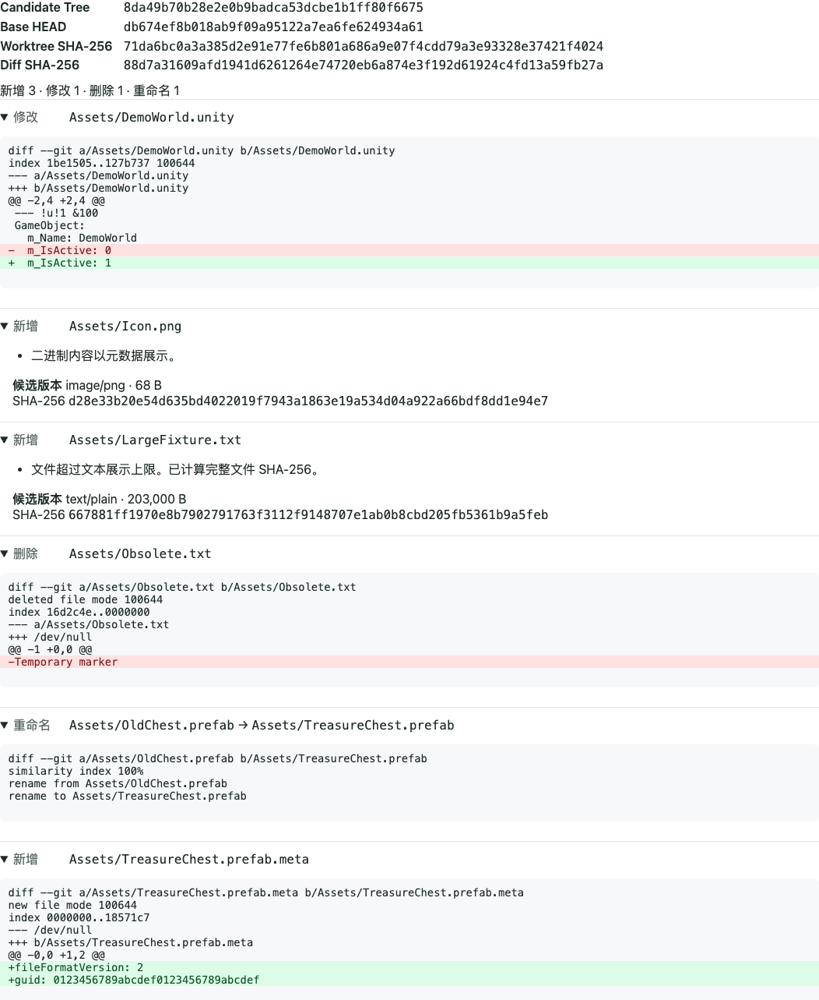

# Sprint 2.4.1 Git 交付验收

| 场景 | 验收条件 |
| --- | --- |
| 候选 Tree | Dashboard 可查看新增、修改、删除、重命名、Unity YAML、二进制摘要及大文件警告。实际提交 Tree 与批准一致。 |
| 安全 | 文件变化及不同 Tree 被拒绝，扫描候选 Blob，外部 Filter/Textconv/Diff Driver 未运行，LFS 或 Gitlink 有明确处理状态。 |
| 凭据 | 系统凭据库不可用后连接已撤销。恢复、重启、重复撤销与缺失条目均幂等。 |
| GitLab | 分别记录 DNS、IPv6 路由、TCP 9998、SNI、证书、代理和服务响应。真实 MR 只能使用独立测试项目。 |
| 回归 | macOS 和 Windows CI 使用 Node 24、冻结锁文件、typecheck、Vitest 和 build。Windows 11 桌面单列。 |

## 候选 Tree 实测

Chrome 打开真实 Dashboard，登录本机 Hub，使用临时 Git Worktree 预览六项合成资源变更，分别展示新增未跟踪文件、差异文本、删除、重命名、PNG 摘要和大文件警告。通过 UI 审批后执行，在实际仓库读取 `HEAD^{tree}`。

- 候选 Tree `8da49b70b28e2e0b9badca53dcbe1b1ff80f6675`
- 实际 Commit Tree `8da49b70b28e2e0b9badca53dcbe1b1ff80f6675`
- 候选 Diff SHA-256 `88d7a31609afd1941d6261264e74720eb6a874e3f192d61924c4fd13a59fb27a`

## GitLab 真实验收边界

| macOS 现场探测 | 结果 |
| --- | --- |
| DNS | `gitlab.pacher.cn` 返回 0 条 A、1 条 AAAA |
| IPv6 路由与 TCP | 系统路由查询可返回结果，固定 IPv6 直连 TCP 9998 返回 `EHOSTUNREACH` |
| 固定 IPv6 代理 | 回环代理响应 CONNECT 200，使用原主机名发送 SNI 后 TLS 被 `ECONNRESET`，证书未送达 |
| 服务状态对照 | 无凭据按主机名发起独立诊断，TLS 1.3 校验通过，证书有效期至 2027-02-12，`/api/v4/user` 返回 401。DevHub 正式连接继续要求固定 IP |
| 独立 MR | GitLab 模拟创建、确认丢失后的查询恢复、重复请求、Diff、Review、Pipeline 和更新通过。没有已登记的独立测试项目及可用 GitLab 登录，真实 Push 与 MR 待验收 |

要补验收，需在目标实例创建独立项目，为本机账号配置测试权限，并提供从本机或受信回环代理到固定公网 IPv6 的 TCP 9998 路由及有效 TLS。正式游戏仓库未参与。

## 凭据和公共依赖

- 临时数据库验证重复撤销、密钥库不可用、删除失败、退避重试和 Hub 重启恢复。删除完成后 SQLite 引用清空，合成令牌未出现在数据库。macOS Keychain 合成条目实测往返和幂等删除通过。
- 旧 Git Fetch 使用独立公共测试仓库 GitHub `octocat/Spoon-Knife`。修改前退出 128。修改后退出 128，记录两次 TLS 握手失败和一次超时，代理有两次上游 TCP 超时。域名、DNS 地址与 SNI 拒绝计数为 0。原生沙箱、日志拦截、公网直连拒绝、npm 与 pnpm 冒烟通过。
